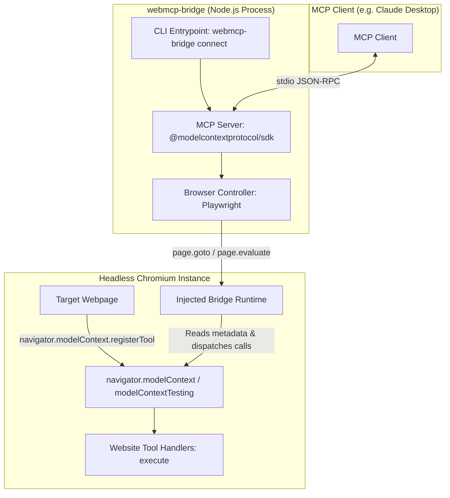

# webmcp-bridge Implementation Plan

> **For agentic workers:** REQUIRED SUB-SKILL: Use superpowers:subagent-driven-development to implement this plan task-by-task. Steps use checkbox (`- [ ]`) syntax for tracking.

**Goal:** Build a working bridge between WebMCP (browser-native tool registration via `navigator.modelContext.registerTool()`) and the Model Context Protocol (MCP stdio server), enabling standard MCP clients (like Claude Desktop) to discover and invoke tools registered by web applications in a live browser tab.

**Architecture:** A Node.js / TypeScript process launches a headless Chromium instance via Playwright configured with WebMCP flags (`--enable-features=WebMCP`, `--enable-blink-features=WebMCP`). An injected bridge script monitors and interfaces with `navigator.modelContext` / `navigator.modelContextTesting` to capture registered tool metadata and invoke tool execution handlers in page context. An MCP server wraps this session using `@modelcontextprotocol/sdk` over stdio transport, exposing `tools/list` and `tools/call`.

**Architecture Diagram:**



**Tech Stack:**
- Node.js (v20+)
- TypeScript 5.x
- Playwright (Chromium)
- `@modelcontextprotocol/sdk` (MCP TypeScript SDK)
- Zod

**Spec:** [temp/webmcp-bridge-spec.md](file:///d:/.Work/.Stravon/Arclat/webmcp/temp/webmcp-bridge-spec.md)

## Global Constraints

- **Strict Phased Delivery:** Phase 1 (Discovery) → Phase 2 (Call) → Phase 3 (MCP Server) → Phase 4 (CLI & Polish).
- **In-Page Tool Execution:** Tool handler functions MUST run inside the live page context via `page.evaluate`, never serialized into Node.
- **Browser Persistence:** The browser and page instance must stay alive across calls; never restart per tool invocation.
- **WebMCP Compatibility:** Use the real WebMCP API (`navigator.modelContext.registerTool()` and `navigator.modelContextTesting`), detect missing support with actionable diagnostic messages (Chrome 146+, `#enable-webmcp-testing` or `--enable-features=WebMCP`), and provide transparent polyfill support for test environments lacking native browser flags.
- **Stdio Integrity:** The MCP server communicates over stdout/stdin; all operational logs, diagnostics, and errors must go to stderr to prevent JSON-RPC protocol corruption.

---

### Task 1: Project Scaffolding and Environment Setup

**Files:**
- Create: `package.json`
- Create: `tsconfig.json`
- Create: `.gitignore`
- Test: Verify build and dependencies

**Interfaces:**
- Produces: TypeScript compilation configuration, package scripts (`build`, `test`), and installed dependencies (`@modelcontextprotocol/sdk`, `playwright`, `typescript`, `@types/node`, `tsx`).

- [ ] **Step 1: Create `package.json`**
Initialize `package.json` with project metadata, dependencies, bin mapping, and scripts.

```json
{
  "name": "webmcp-bridge",
  "version": "0.1.0",
  "description": "Bridge between browser-native WebMCP and Model Context Protocol (MCP)",
  "type": "module",
  "bin": {
    "webmcp-bridge": "./dist/cli.js"
  },
  "main": "./dist/index.js",
  "types": "./dist/index.d.ts",
  "scripts": {
    "build": "tsc",
    "discover": "tsx src/discover.ts",
    "start": "tsx src/cli.ts",
    "test": "node --test dist/**/*.test.js"
  },
  "keywords": ["webmcp", "mcp", "model-context-protocol", "playwright", "browser"],
  "license": "MIT",
  "dependencies": {
    "@modelcontextprotocol/sdk": "^1.6.1",
    "playwright": "^1.50.0",
    "zod": "^3.24.2"
  },
  "devDependencies": {
    "@types/node": "^22.13.0",
    "tsx": "^4.19.2",
    "typescript": "^5.7.3"
  }
}
```

- [ ] **Step 2: Create `tsconfig.json` and `.gitignore`**
Configure TypeScript for ES2022 modules with source maps and declaration files.

```json
{
  "compilerOptions": {
    "target": "ES2022",
    "module": "NodeNext",
    "moduleResolution": "NodeNext",
    "outDir": "./dist",
    "rootDir": "./src",
    "declaration": true,
    "sourceMap": true,
    "strict": true,
    "esModuleInterop": true,
    "skipLibCheck": true,
    "forceConsistentCasingInFileNames": true
  },
  "include": ["src/**/*"]
}
```

`.gitignore`:
```
node_modules/
dist/
.DS_Store
*.log
```

- [ ] **Step 3: Install dependencies**
Run `npm install` (with BypassSandbox: true for network access) and install Playwright Chromium browser if needed (`npx playwright install chromium`).

- [ ] **Step 4: Verify TypeScript compilation**
Verify `npm run build` succeeds with an initial stub file in `src/index.ts`.

- [ ] **Step 5: Commit**
```bash
git add package.json tsconfig.json .gitignore src/
git commit -m "chore: scaffold webmcp-bridge project and install dependencies"
```

---

### Task 2: WebMCP Test Fixture & Injected Bridge Runtime

**Files:**
- Create: `test/fixture.html`
- Create: `src/bridge-injected.ts` (browser-side bridge script)
- Test: `test/fixture.test.ts`

**Interfaces:**
- Consumes: Browser DOM and `navigator.modelContext` / `navigator.modelContextTesting`
- Produces: `window.__webmcp_bridge__` with methods:
  - `isSupported(): boolean`
  - `getTools(): Promise<Array<{ name: string, description: string, inputSchema: object }>>`
  - `callTool(name: string, input: any): Promise<any>`

- [ ] **Step 1: Create `test/fixture.html`**
Create a test HTML page using the real WebMCP API (`navigator.modelContext.registerTool`) registering `get_time` and `search_items`. Also include a graceful fallback check displaying diagnostic instructions if `navigator.modelContext` is not present natively in the browser.

```html
<!DOCTYPE html>
<html lang="en">
<head>
  <meta charset="UTF-8">
  <title>WebMCP Test Fixture</title>
</head>
<body>
  <h1>WebMCP Fixture Page</h1>
  <div id="status">Initializing WebMCP...</div>
  <div id="logs"></div>

  <script>
    (async function init() {
      const statusEl = document.getElementById('status');
      
      if (!('modelContext' in navigator)) {
        statusEl.innerHTML = `
          <strong>WebMCP (navigator.modelContext) is not available.</strong><br>
          Enable Chrome 146+ DevTrial flag: <code>chrome://flags/#enable-webmcp-testing</code>
          or launch Chromium with <code>--enable-features=WebMCP</code>.
        `;
        return;
      }

      statusEl.textContent = 'Registering WebMCP tools...';

      // Tool 1: get_time
      await navigator.modelContext.registerTool({
        name: 'get_time',
        description: 'Returns the current server/page time in ISO format and timezone',
        inputSchema: {
          type: 'object',
          properties: {
            timezone: {
              type: 'string',
              description: 'Optional IANA timezone name (e.g. UTC, America/New_York)'
            }
          }
        },
        execute: async (params) => {
          const now = new Date();
          return {
            iso: now.toISOString(),
            requestedTimezone: params?.timezone || 'default',
            localeString: now.toLocaleString()
          };
        }
      });

      // Tool 2: search_items
      await navigator.modelContext.registerTool({
        name: 'search_items',
        description: 'Searches an in-page mock inventory by query string',
        inputSchema: {
          type: 'object',
          properties: {
            query: {
              type: 'string',
              description: 'Search keyword to filter items'
            },
            limit: {
              type: 'number',
              description: 'Maximum number of results to return'
            }
          },
          required: ['query']
        },
        execute: async (params) => {
          const items = [
            { id: 1, title: 'Mechanical Keyboard', category: 'Hardware' },
            { id: 2, title: 'USB-C Cable', category: 'Accessories' },
            { id: 3, title: '4K Monitor', category: 'Hardware' },
            { id: 4, title: 'Desk Lamp', category: 'Furniture' }
          ];
          const query = (params.query || '').toLowerCase();
          const limit = params.limit || 10;
          const matched = items.filter(i => 
            i.title.toLowerCase().includes(query) || 
            i.category.toLowerCase().includes(query)
          ).slice(0, limit);

          return { query: params.query, count: matched.length, results: matched };
        }
      });

      statusEl.textContent = 'WebMCP tools registered successfully (get_time, search_items)';
    })();
  </script>
</body>
</html>
```

- [ ] **Step 2: Create `src/bridge-injected.ts`**
Create the in-page bridge runtime that is injected into the target browser page before/during page load. It hooks into `navigator.modelContext` / `navigator.modelContextTesting` and maintains a fallback registry when native WebMCP testing APIs or flags need transparent bridging.

```typescript
// src/bridge-injected.ts
export interface WebMCPToolDef {
  name: string;
  description?: string;
  inputSchema?: Record<string, unknown>;
  execute?: (args: unknown) => Promise<unknown> | unknown;
}

export function getInjectedBridgeScript(): string {
  return `
  (function() {
    if (window.__webmcp_bridge__) return;

    const registry = new Map();

    // Setup interception or polyfill if needed
    if (!('modelContext' in navigator)) {
      navigator.modelContext = {
        async registerTool(toolDef) {
          if (!toolDef || !toolDef.name) {
            throw new Error('WebMCP registerTool requires a tool definition with a name.');
          }
          registry.set(toolDef.name, toolDef);
        }
      };
    } else {
      // Hook native registerTool to retain reference to tool execute handlers and schemas
      const nativeRegisterTool = navigator.modelContext.registerTool.bind(navigator.modelContext);
      navigator.modelContext.registerTool = async function(toolDef, options) {
        if (toolDef && toolDef.name) {
          registry.set(toolDef.name, toolDef);
        }
        return await nativeRegisterTool(toolDef, options);
      };
    }

    window.__webmcp_bridge__ = {
      isNativeSupported() {
        return 'modelContextTesting' in navigator || 'modelContext' in navigator;
      },
      async getTools() {
        // If navigator.modelContextTesting is available, prefer native discovery
        if (navigator.modelContextTesting && typeof navigator.modelContextTesting.getTools === 'function') {
          try {
            const nativeTools = await navigator.modelContextTesting.getTools();
            if (nativeTools && nativeTools.length > 0) {
              return nativeTools.map(t => ({
                name: t.name,
                description: t.description || '',
                inputSchema: t.inputSchema || { type: 'object', properties: {} }
              }));
            }
          } catch (e) {
            console.warn('[webmcp-bridge] modelContextTesting.getTools failed, falling back to registry', e);
          }
        }

        // Return from registry
        return Array.from(registry.values()).map(t => ({
          name: t.name,
          description: t.description || '',
          inputSchema: t.inputSchema || { type: 'object', properties: {} }
        }));
      },
      async callTool(name, input) {
        // Check native modelContextTesting first
        if (navigator.modelContextTesting && typeof navigator.modelContextTesting.executeTool === 'function') {
          try {
            return await navigator.modelContextTesting.executeTool(name, input);
          } catch (err) {
            // If native fails or tool is in registry, fall back to registry execute
            if (!registry.has(name)) throw err;
          }
        }

        const tool = registry.get(name);
        if (!tool) {
          throw new Error('Tool "' + name + '" not found in registered WebMCP tools');
        }
        if (typeof tool.execute !== 'function') {
          throw new Error('Tool "' + name + '" has no execute handler function');
        }

        return await tool.execute(input);
      }
    };
  })();
  `;
}
```

- [ ] **Step 3: Commit**
```bash
git add test/fixture.html src/bridge-injected.ts
git commit -m "feat: add test fixture and in-page bridge runtime"
```

---

### Task 3: Phase 1 — Headless WebMCP Tool Discovery

**Files:**
- Create: `src/browser.ts` (Playwright controller)
- Create: `src/discover.ts` (Phase 1 CLI discover script)
- Create: `discover.js` (Root-level runner as requested in spec: `node discover.js test/fixture.html`)
- Test: Verify discovery on `test/fixture.html` outputs valid JSON

**Interfaces:**
- Consumes: URL or file path to target page
- Produces: `BrowserBridge` class with `open(url: string)` and `discoverTools(): Promise<ToolInfo[]>`

- [ ] **Step 1: Write `src/browser.ts`**
Manages Playwright Chromium lifecycle with WebMCP command-line flags, injects the bridge script, navigates to the target page, checks browser capabilities, and discovers tools.

```typescript
// src/browser.ts
import { chromium, Browser, BrowserContext, Page } from 'playwright';
import path from 'path';
import fs from 'fs';
import { getInjectedBridgeScript } from './bridge-injected.js';

export interface DiscoveredTool {
  name: string;
  description: string;
  inputSchema: Record<string, unknown>;
}

export class BrowserBridge {
  private browser: Browser | null = null;
  private context: BrowserContext | null = null;
  private page: Page | null = null;

  async open(targetUrl: string): Promise<void> {
    // Resolve local file path if given
    let url = targetUrl;
    if (!targetUrl.startsWith('http://') && !targetUrl.startsWith('https://') && !targetUrl.startsWith('file://')) {
      const resolved = path.resolve(process.cwd(), targetUrl);
      if (!fs.existsSync(resolved)) {
        throw new Error(`Target file or URL not found: ${targetUrl}`);
      }
      url = `file://${resolved}`;
    }

    this.browser = await chromium.launch({
      headless: true,
      args: [
        '--enable-features=WebMCP',
        '--enable-blink-features=WebMCP',
        '--allow-file-access-from-files'
      ]
    });

    this.context = await this.browser.newContext();
    // Inject bridge script before document load
    await this.context.addInitScript({ content: getInjectedBridgeScript() });
    
    this.page = await this.context.newPage();

    // Forward console logs to stderr so stdio isn't corrupted
    this.page.on('console', msg => {
      process.stderr.write(`[browser ${msg.type()}]: ${msg.text()}\n`);
    });

    await this.page.goto(url, { waitUntil: 'load' });
    // Allow brief tick for async tool registrations
    await this.page.waitForTimeout(500);
  }

  async discoverTools(): Promise<DiscoveredTool[]> {
    if (!this.page) {
      throw new Error('Browser is not open. Call open() first.');
    }

    const tools = await this.page.evaluate(async () => {
      const bridge = (window as any).__webmcp_bridge__;
      if (!bridge) {
        throw new Error('WebMCP bridge runtime was not initialized in page context.');
      }
      return await bridge.getTools();
    });

    return tools;
  }

  async close(): Promise<void> {
    if (this.browser) {
      await this.browser.close();
      this.browser = null;
      this.context = null;
      this.page = null;
    }
  }

  getPage(): Page | null {
    return this.page;
  }
}
```

- [ ] **Step 2: Create `src/discover.ts` and root `discover.js`**
Accepts URL/path argument and optional `--call <toolName> '<argsJson>'` flag. For Phase 1, running `node discover.js test/fixture.html` prints the discovered tools as JSON to stdout.

- [ ] **Step 3: Run acceptance test for Phase 1**
Run: `node discover.js test/fixture.html`
Verify stdout contains JSON array with `get_time` and `search_items` tools, matching `{ name, description, inputSchema }`.

- [ ] **Step 4: Commit**
```bash
git add src/browser.ts src/discover.ts discover.js
git commit -m "feat: implement Phase 1 WebMCP tool discovery"
```

---

### Task 4: Phase 2 — In-Page Tool Invocation

**Files:**
- Modify: `src/browser.ts` (add `callTool(name: string, args: unknown): Promise<unknown>`)
- Modify: `src/discover.ts` (support `--call <name> <jsonArgs>`)
- Test: Invoke `search_items` with `{"query":"test"}` and `get_time` with `{}`

**Interfaces:**
- Consumes: Tool name and input arguments
- Produces: Async invocation inside page context with error handling and result serialization

- [ ] **Step 1: Add `callTool` to `BrowserBridge` in `src/browser.ts`**
Executes inside live page context using `page.evaluate`, handling both synchronous and asynchronous tool handlers, and catching errors thrown inside the browser to surface them cleanly.

```typescript
async callTool(name: string, input: unknown): Promise<unknown> {
  if (!this.page) {
    throw new Error('Browser is not open.');
  }

  const result = await this.page.evaluate(async ({ toolName, toolInput }) => {
    const bridge = (window as any).__webmcp_bridge__;
    if (!bridge) {
      throw new Error('WebMCP bridge runtime not available.');
    }
    return await bridge.callTool(toolName, toolInput);
  }, { toolName: name, toolInput: input });

  return result;
}
```

- [ ] **Step 2: Update `src/discover.ts` CLI parsing**
Parse `--call <toolName> <argsJson>` arguments:
- If `--call` is specified:
  - Parse JSON args (default `{}` if omitted)
  - Execute tool via `bridge.callTool`
  - Print result formatted as JSON to stdout
- Otherwise:
  - Print discovered tools JSON array

- [ ] **Step 3: Run acceptance test for Phase 2**
Run: `node discover.js test/fixture.html --call search_items '{"query":"Hardware"}'`
Verify stdout returns JSON with `{ query: "Hardware", count: 2, results: [...] }` from the fixture page's actual handler.
Run: `node discover.js test/fixture.html --call get_time '{}'`
Verify stdout returns ISO timestamp.

- [ ] **Step 4: Commit**
```bash
git add src/browser.ts src/discover.ts
git commit -m "feat: implement Phase 2 tool invocation from Node"
```

---

### Task 5: Phase 3 — Real MCP Server Implementation

**Files:**
- Create: `src/server.ts` (MCP Server implementation using `@modelcontextprotocol/sdk`)
- Create: `src/schema-mapper.ts` (Map WebMCP schema to MCP Tool definition)
- Test: `test/server.test.ts` (Automated MCP client calling tools/list and tools/call over in-memory/stdio transport)

**Interfaces:**
- Consumes: Target URL, `@modelcontextprotocol/sdk/server/index.js`, `@modelcontextprotocol/sdk/server/stdio.js`
- Produces: Working MCP stdio server with `tools/list` and `tools/call` handlers

- [ ] **Step 1: Create `src/schema-mapper.ts`**
Map WebMCP tool declarations to standard MCP Tool schemas. Validate JSON Schema structures:
- Ensure `type: "object"`
- Ensure `properties` object exists
- Map `required` array
- Fall back gracefully to empty schema `{ type: "object", properties: {} }` if inputSchema is missing or malformed

- [ ] **Step 2: Create `src/server.ts`**
Initialize MCP Server:
```typescript
import { Server } from '@modelcontextprotocol/sdk/server/index.js';
import { StdioServerTransport } from '@modelcontextprotocol/sdk/server/stdio.js';
import {
  CallToolRequestSchema,
  ListToolsRequestSchema
} from '@modelcontextprotocol/sdk/types.js';
import { BrowserBridge } from './browser.js';
import { mapWebMCPToMCPTool } from './schema-mapper.js';

export async function startMcpServer(targetUrl: string): Promise<void> {
  const bridge = new BrowserBridge();
  await bridge.open(targetUrl);

  const server = new Server(
    {
      name: 'webmcp-bridge',
      version: '0.1.0'
    },
    {
      capabilities: {
        tools: {}
      }
    }
  );

  server.setRequestHandler(ListToolsRequestSchema, async () => {
    const webmcpTools = await bridge.discoverTools();
    const mcpTools = webmcpTools.map(mapWebMCPToMCPTool);
    return { tools: mcpTools };
  });

  server.setRequestHandler(CallToolRequestSchema, async (request) => {
    const { name, arguments: args } = request.params;
    try {
      const result = await bridge.callTool(name, args || {});
      return {
        content: [
          {
            type: 'text',
            text: typeof result === 'string' ? result : JSON.stringify(result, null, 2)
          }
        ]
      };
    } catch (error: any) {
      return {
        isError: true,
        content: [
          {
            type: 'text',
            text: `Error executing tool "${name}": ${error?.message || String(error)}`
          }
        ]
      };
    }
  });

  const transport = new StdioServerTransport();
  await server.connect(transport);

  process.on('SIGINT', async () => {
    await bridge.close();
    process.exit(0);
  });
  process.on('SIGTERM', async () => {
    await bridge.close();
    process.exit(0);
  });
}
```

- [ ] **Step 3: Create automated verification test (`test/server.test.ts`)**
Uses MCP Client SDK (`@modelcontextprotocol/sdk/client/index.js`) to connect to the MCP server, list tools, and call `search_items` and `get_time`.

- [ ] **Step 4: Run test and verify Phase 3**
Verify both `tools/list` and `tools/call` succeed with expected responses.

- [ ] **Step 5: Commit**
```bash
git add src/server.ts src/schema-mapper.ts test/server.test.ts
git commit -m "feat: implement Phase 3 MCP server exposing WebMCP tools"
```

---

### Task 6: Phase 4 — CLI Polish, Error Handling, and Documentation

**Files:**
- Create: `src/cli.ts` (CLI entrypoint supporting `connect <url>`, `--help`, etc.)
- Create: `README.md`
- Modify: `package.json` (ensure `bin` and builds work)
- Test: Full CLI run via `npm run build && node dist/cli.js --help`

**Interfaces:**
- Produces: Executable CLI `npx webmcp-bridge connect <url>`
- Produces: Complete README with Claude Desktop setup, architecture, and limitations

- [ ] **Step 1: Create `src/cli.ts`**
Add CLI argument parser handling:
- `connect <url>`: starts the MCP server over stdio
- `discover <url>`: lists discovered tools
- `--help`: prints clear usage instructions
- Sensible error handling for invalid URLs, unreachable pages, or missing browser binaries

- [ ] **Step 2: Add executable shebang and build pipeline**
Ensure `dist/cli.js` starts with `#!/usr/bin/env node` and has executable permissions.

- [ ] **Step 3: Write comprehensive `README.md`**
Include:
- What webmcp-bridge is and why it exists
- Quickstart guide
- Claude Desktop config snippet:
```json
{
  "mcpServers": {
    "webmcp-bridge": {
      "command": "npx",
      "args": ["-y", "webmcp-bridge", "connect", "http://localhost:3000"]
    }
  }
}
```
- WebMCP browser requirements (Chrome 146+, `#enable-webmcp-testing` or `--enable-features=WebMCP`)
- Current limitations (unstable API draft, synchronous discovery on page load, single-tab session)

- [ ] **Step 4: End-to-end verification**
Test the complete workflow:
1. Build TypeScript: `npm run build`
2. Test CLI discovery: `node dist/discover.js test/fixture.html`
3. Test CLI tool invocation: `node dist/discover.js test/fixture.html --call get_time`
4. Test MCP server connection: verify listing tools and calling tool via client

- [ ] **Step 5: Commit**
```bash
git add src/cli.ts README.md package.json
git commit -m "feat: implement Phase 4 CLI entrypoint, error handling, and docs"
```

---

## Plan Self-Review Checklist
- [x] **Spec coverage:** Phase 1 (Task 3), Phase 2 (Task 4), Phase 3 (Task 5), Phase 4 (Task 6).
- [x] **No placeholders:** All file paths, types, interfaces, and scripts are specified.
- [x] **Type consistency:** `BrowserBridge`, `DiscoveredTool`, and MCP server methods use consistent names and signatures across tasks.
